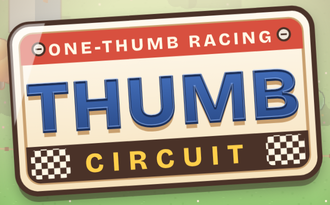

# Thumb Circuit

**Tiny cars. Big drifts. One thumb.**

[**Play the sample**](https://lfcfoundry.github.io/thumb-circuit/play/) · [**About**](https://lfcfoundry.github.io/thumb-circuit/) · [**Source code**](https://github.com/lfcfoundry/thumb-circuit)

     

## What it is and how it works

A one-thumb racing game for phones, played in portrait. The car drives itself forward and your thumb steers, so a race is a slide, a tap and a lot of drifting. Win races to earn coins, experience and fans, then spend them in the garage on upgrades, new cars, paint and recruited drivers. The sample has eight tracks, levels that unlock cars, drivers and tracks, and a few stunts and surprises on the road. It is one offline HTML file that saves progress in your browser.

## Why it exists

A rewarding, incremental racing loop you can play with a single thumb, in the same cozy, single-file spirit as the other LFC Foundry games: no ads, no accounts, no network, no sound, single player, open source.

## Made for anyone, kept simple

- **No ads.** Not one, anywhere in the game.
- **No accounts.** Nothing to sign up for or log in to.
- **No data sent anywhere.** The page makes no network requests. Progress stays in your own browser.
- **No purchases.** Coins and cars are earned in the game. Nothing is sold for real money.
- **Fully open source.** MIT licensed, with every line on GitHub for anyone to read, copy or change.
- **Works offline.** One self-contained file. Once it has loaded, you can play with no connection.
- **Single player.** Just you against the computer rivals.
- **No sound.** The game is silent by design. Phones may give a short buzz at some moments.

## Highlights

| Steer with a slide | Rocket start | Underdog Rocket | Eight tracks |
|---|---|---|---|
| Hold your thumb on the screen and slide to steer. The road gives a little help, but it never pulls you to the middle of the lane. | Tap Boost right at the green light for a head start. Tap too early and you lose it. | When you are behind, a pink bar above Boost fills faster. When it is full, double-tap Boost for a short rocket burst. | Meadow, orchard, beach, candy, ice, autumn woods, a figure eight that crosses itself on a bridge, and Big Top Loop, a circus track with a loop-de-loop. |

| Under the bridge | Rivals that keep it close | Fan milestones | Changing road surfaces |
|---|---|---|---|
| Cars drive under the bridge as outlines, with shadows on the deck, and coins sit on the bridge too. | Easy, Normal and Hard settings. On Easy and Normal, rivals push a little when you are far ahead. Hard adds wet, icy and sticky road. | New car looks unlock as your fans grow. A monster truck is earned free at 200 lifetime fans and is not for sale. | Packed dirt, asphalt, cobblestone and concrete by section, with tire and burn marks. One track has a speed bump. |

| Trackside life | Close racing | Garage and drivers | Secrets and unlockables |
|---|---|---|---|
| People with legs and faces, fan groups with flags, balloons and kites, a chimp on a tiki throne, and a submarine on the lake. | Sit right behind a rival for a slipstream boost. A close-call bonus, a final-lap hunter and a slow-motion photo finish keep the last laps tense. | Buy cars, pick paint and stripe colors, and recruit drivers with faces and perks. | Odd vehicles to earn and a few surprises to find. No spoilers here. |

**Also in the sample:** live 3D cars and headlights at dusk with WebGL2, and a Canvas picture when your browser does not have it. On a computer, the arrow keys steer and the space bar is Boost.

## Status

**Sample, version 7.40 (test build).** v7.x has passed robot races only so far; it has not had full human testing. The sample is playable and changes often, so small things still move between versions. It now has a campaign, "Road to the Big Top," with six towns. Steering with road help off is still being tuned. The real game build is not started yet. See the [changelog](CHANGELOG.md) for what changed in each version. Only Chromium has been checked for v5.31 and later, so Firefox and WebKit are unverified.

## Docs

- [Landing page](index.html): the public overview, served through GitHub Pages.
- [Design doc](docs/DESIGN.md): every decision so far, the plan and open questions.
- [Decisions log](docs/DECISIONS-2026.11.09.md): owner decisions from the sample, in order.
- [Changelog](CHANGELOG.md): one plain line per version.
- [Throwaway palette sample](docs/art/palette-sample-throwaway.png): three color moods as a rough mockup, not final art.

## Not built yet

Pit and repair crews, last-corner replay, sponsors and regions, track unlock rules, a copy-paste save code, sound (none is planned), and a hidden speed report and error log.

## License

MIT, see [LICENSE](LICENSE). Copyright (c) 2026 LFC Foundry. Thumb Circuit is a working name.
